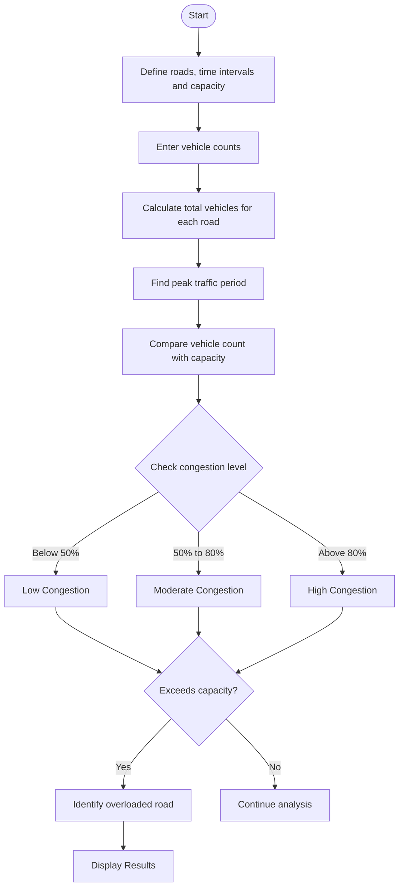

# Problem Statement
To develop a Python program that analyzes vehicle counts across multiple roads and time intervals. The program calculates total traffic, identifies peak traffic periods, classifies congestion levels as Low, Moderate, or High, and identifies roads where vehicle counts exceed the specified capacity.
# Algorithm
1. Start the program.
2. Define the roads, time intervals, vehicle counts, and road capacity.
3. Calculate the total number of vehicles recorded on each road.
4. Find the time interval with the highest vehicle count.
5. Classify congestion based on the vehicle count:
   - Low: below 50% of capacity.
   - Moderate: 50% to 80% of capacity.
   - High: above 80% of capacity.
6. Check whether the vehicle count exceeds road capacity.
7. Display total traffic, peak traffic period, congestion levels, and overloaded roads.
8. Stop the program.
# Mermaid Flowchart

# Code

# Traffic Flow and Congestion Analysis

roads = {
    "Main Road": [40, 85, 120],
    "Ring Road": [30, 65, 90],
    "Highway": [60, 110, 140]
}

time_intervals = ["Morning", "Afternoon", "Evening"]
capacity = 100

# Calculate total vehicles on each road
print("TRAFFIC FLOW ANALYSIS")

for road, counts in roads.items():
    total = sum(counts)
    print(f"\nRoad: {road}")
    print(f"Total vehicles: {total}")

    for i in range(len(time_intervals)):
        vehicles = counts[i]
        percentage = (vehicles / capacity) * 100

        if percentage < 50:
            level = "Low"
        elif percentage <= 80:
            level = "Moderate"
        else:
            level = "High"

        print(
            f"{time_intervals[i]}: {vehicles} vehicles - "
            f"{level} Congestion"
        )

        if vehicles > capacity:
            print("Warning: Road capacity exceeded!")

# Find peak traffic period
totals = [
    sum(counts[i] for counts in roads.values())
    for i in range(len(time_intervals))
]

peak_index = totals.index(max(totals))

print("\nPEAK TRAFFIC ANALYSIS")
print("Peak period:", time_intervals[peak_index])
print("Total vehicles:", totals[peak_index])

# Display roads exceeding capacity
print("\nROADS EXCEEDING CAPACITY")

found = False

for road, counts in roads.items():
    for i, vehicles in enumerate(counts):
        if vehicles > capacity:
            print(
                f"{road} - {time_intervals[i]}: "
                f"{vehicles} vehicles"
            )
            found = True

if not found:
    print("No roads exceeded capacity.")
# input
Roads: Main Road, Ring Road, Highway
Time intervals: Morning, Afternoon, Evening
Capacity per road per interval: 100 vehicles

Main Road: 40, 85, 120
Ring Road: 30, 65, 90
Highway: 60, 110, 140
# output
TRAFFIC FLOW ANALYSIS

Road: Main Road
Total vehicles: 245
Morning: 40 vehicles - Low Congestion
Afternoon: 85 vehicles - High Congestion
Evening: 120 vehicles - High Congestion
Warning: Road capacity exceeded!

Road: Ring Road
Total vehicles: 185
Morning: 30 vehicles - Low Congestion
Afternoon: 65 vehicles - Moderate Congestion
Evening: 90 vehicles - High Congestion

Road: Highway
Total vehicles: 310
Morning: 60 vehicles - Moderate Congestion
Afternoon: 110 vehicles - High Congestion
Warning: Road capacity exceeded!
Evening: 140 vehicles - High Congestion
Warning: Road capacity exceeded!

PEAK TRAFFIC ANALYSIS
Peak period: Evening
Total vehicles: 350

ROADS EXCEEDING CAPACITY
Main Road - Evening: 120 vehicles
Highway - Afternoon: 110 vehicles
    M --> N
    N --> O([Stop])
# Sreenshot

