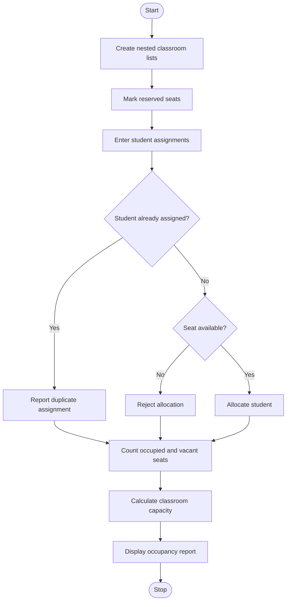

# Problem Statement
To develop a Python program using nested lists to represent multiple classrooms and their seating positions. The program allocates students to seats, preserves reserved seats, detects duplicate student assignments, and calculates occupied seats, vacant seats, and total classroom capacity.
# Algorithm
1. Start the program.
2. Create nested lists to represent classrooms and seating positions.
3. Mark reserved seats using a special value.
4. Allocate students to available seats.
5. Check for duplicate student assignments.
6. Count occupied seats, reserved seats, and vacant seats.
7. Calculate the total capacity of each classroom.
8. Display the classroom occupancy details.
9. Stop the program.
# Mermaid Flowchart

# Source Code (Python)

# Nested List Classroom Occupancy Analysis

classrooms = {
    "Classroom A": [
        ["Alice", None, "RESERVED"],
        [None, "Bob", None]
    ],
    "Classroom B": [
        [None, "Charlie", None],
        ["David", None, "RESERVED"]
    ]
}

# Student allocation requests
assignments = [
    ("Classroom A", 0, 1, "Eve"),
    ("Classroom A", 1, 0, "Frank"),
    ("Classroom B", 0, 0, "Alice"),
    ("Classroom B", 1, 1, "Grace")
]

print("CLASSROOM OCCUPANCY ANALYSIS")

# Allocate students
for room, row, col, student in assignments:
    seats = classrooms[room]

    # Check duplicate student assignment
    already_assigned = any(
        student == seat
        for classroom in classrooms.values()
        for seat_row in classroom
        for seat in seat_row
    )

    if already_assigned:
        print(f"Duplicate assignment rejected: {student}")
        continue

    # Check whether the seat is available
    if seats[row][col] is None:
        seats[row][col] = student
        print(f"{student} allocated to {room}")
    else:
        print(f"Seat unavailable for {student} in {room}")

# Display occupancy details
print("\nFINAL CLASSROOM REPORT")

total_capacity = 0
total_occupied = 0
total_reserved = 0
total_vacant = 0

for room, seats in classrooms.items():
    capacity = sum(len(row) for row in seats)
    occupied = sum(
        seat is not None and seat != "RESERVED"
        for row in seats for seat in row
    )
    reserved = sum(
        seat == "RESERVED"
        for row in seats for seat in row
    )
    vacant = capacity - occupied - reserved

    print(f"\n{room}")
    print(f"Total seats: {capacity}")
    print(f"Occupied seats: {occupied}")
    print(f"Reserved seats: {reserved}")
    print(f"Vacant seats: {vacant}")

    total_capacity += capacity
    total_occupied += occupied
    total_reserved += reserved
    total_vacant += vacant

print("\nOVERALL SUMMARY")
print("Total capacity:", total_capacity)
print("Total occupied:", total_occupied)
print("Total reserved:", total_reserved)
print("Total vacant:", total_vacant)
# Sample Input
Classroom A:
Alice, Empty, Reserved
Empty, Bob, Empty

Classroom B:
Empty, Charlie, Empty
David, Empty, Reserved

Allocation requests:
Eve   -> Classroom A, row 0, seat 1
Frank -> Classroom A, row 1, seat 0
Alice -> Classroom B, row 0, seat 0
Grace -> Classroom B, row 1, seat 1
# Sample Output
CLASSROOM OCCUPANCY ANALYSIS
Eve allocated to Classroom A
Frank allocated to Classroom A
Duplicate assignment rejected: Alice
Grace allocated to Classroom B

FINAL CLASSROOM REPORT

Classroom A
Total seats: 6
Occupied seats: 4
Reserved seats: 1
Vacant seats: 1

Classroom B
Total seats: 6
Occupied seats: 3
Reserved seats: 1
Vacant seats: 2

OVERALL SUMMARY
Total capacity: 12
Total vacant: 3
# Screen shot

Total occupied: 7
Total reserved: 2
