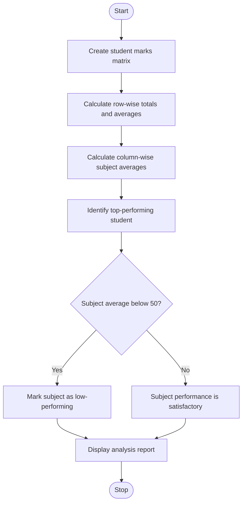

# Problem Statement
To develop a Python program using a matrix (nested list) to analyze student marks across multiple subjects. The program calculates each student's total and average marks, determines subject-wise averages, identifies top-performing students, and detects subjects with low average performance.
# Algorithm
1. Start the program.
2. Store student names, subject names, and marks in a matrix.
3. Calculate the total and average marks of each student (row-wise).
4. Calculate the average marks for each subject (column-wise).
5. Identify the student with the highest average marks.
6. Identify subjects whose average marks are below 50.
7. Display all statistics and results.
8. Stop the program.
# Mermaid Flowchart

# Source Code (Python)

# Student Marks Matrix Analysis

students = ["Alice", "Bob", "Charlie", "David"]
subjects = ["Python", "Maths", "English"]

marks = [
    [85, 90, 80],
    [70, 65, 75],
    [45, 50, 40],
    [95, 92, 88]
]

print("STUDENT MARKS ANALYSIS")

# Row-wise statistics
averages = []

for i in range(len(students)):
    total = sum(marks[i])
    average = total / len(subjects)
    averages.append(average)

    print(f"\nStudent: {students[i]}")
    print("Total marks:", total)
    print(f"Average marks: {average:.2f}")

# Column-wise statistics
print("\nSUBJECT-WISE AVERAGES")

subject_averages = []

for j in range(len(subjects)):
    total = sum(marks[i][j] for i in range(len(students)))
    average = total / len(students)
    subject_averages.append(average)

    print(f"{subjects[j]}: {average:.2f}")

# Identify top-performing student
highest_average = max(averages)

print("\nTOP PERFORMER(S)")
for i in range(len(students)):
    if averages[i] == highest_average:
        print(students[i], "-", f"{averages[i]:.2f}")

# Detect low-performing subjects
print("\nLOW-PERFORMING SUBJECTS")
found = False

for j in range(len(subjects)):
    if subject_averages[j] < 50:
        print(subjects[j], "-", f"{subject_averages[j]:.2f}")
        found = True

if not found:
    print("No subjects have an average below 50.")
# Sample Input
Students: Alice, Bob, Charlie, David
Subjects: Python, Maths, English

Marks Matrix:
[
    [85, 90, 80],
    [70, 65, 75],
    [45, 50, 40],
    [95, 92, 88]
]
# Sample Output
STUDENT MARKS ANALYSIS

Student: Alice
Total marks: 255
Average marks: 85.00

Student: Bob
Total marks: 210
Average marks: 70.00

Student: Charlie
Total marks: 135
Average marks: 45.00

Student: David
Total marks: 275
Average marks: 91.67

SUBJECT-WISE AVERAGES
Python: 73.75
Maths: 74.25
English: 70.75

TOP PERFORMER(S)
David - 91.67

LOW-PERFORMING SUBJECTS
No subjects have an average below 50.
# Screen shot

