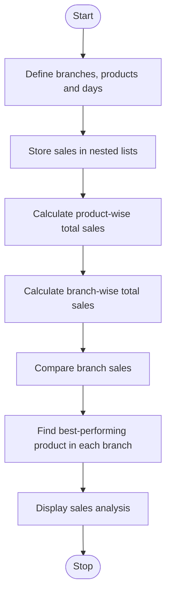

# Problem Statement
To develop a Python program using nested lists to store product sales across multiple branches and days. The program calculates total sales for each product, compares sales between branches, and identifies the best-performing product in each branch.
# Algorithm
1. Start the program.
2. Define branch names, product names, and days.
3. Store daily product sales in nested lists.
4. Calculate the total sales of each product across all branches and days.
5. Calculate the total sales of each branch.
6. Compare the total sales of all branches.
7. Identify the best-performing product in each branch.
8. Display the sales analysis and comparison results.
9. Stop the program.
# Mermaid Flowchart

# Source code

# Multi-Branch Sales Matrix Comparison

branches = ["Branch A", "Branch B", "Branch C"]
products = ["Laptop", "Mobile", "Tablet"]
days = ["Monday", "Tuesday", "Wednesday"]

# Sales format: branch -> product -> daily sales
sales = [
    [[10, 12, 8], [20, 15, 18], [8, 10, 12]],
    [[15, 10, 12], [18, 20, 22], [12, 14, 10]],
    [[8, 10, 12], [25, 20, 15], [10, 12, 14]]
]

product_totals = [0] * len(products)
branch_totals = []

print("MULTI-BRANCH SALES ANALYSIS")

for i in range(len(branches)):
    print(f"\n{branches[i]}")
    current_branch_total = 0
    product_sales = []

    for j in range(len(products)):
        total = sum(sales[i][j])
        product_sales.append(total)
        product_totals[j] += total
        current_branch_total += total

        print(f"{products[j]} total sales: {total}")

    branch_totals.append(current_branch_total)

    # Best-performing product in this branch
    best_index = product_sales.index(max(product_sales))
    print("Best-performing product:",
          products[best_index])
    print("Branch total sales:", current_branch_total)

# Product-wise totals across all branches
print("\nPRODUCT-WISE TOTAL SALES")
for i in range(len(products)):
    print(f"{products[i]}: {product_totals[i]}")

# Compare branches
print("\nBRANCH-WISE SALES COMPARISON")
for i in range(len(branches)):
    print(f"{branches[i]}: {branch_totals[i]}")

best_branch = branch_totals.index(max(branch_totals))
print("\nBest-performing branch:", branches[best_branch])
print("Total sales:", branch_totals[best_branch])
# Sample input
Branches: Branch A, Branch B, Branch C
Products: Laptop, Mobile, Tablet
Days: Monday, Tuesday, Wednesday

Branch A:
Laptop: 10, 12, 8
Mobile: 20, 15, 18
Tablet: 8, 10, 12

Branch B:
Laptop: 15, 10, 12
Mobile: 18, 20, 22
Tablet: 12, 14, 10

Branch C:
Laptop: 8, 10, 12
Mobile: 25, 20, 15
Tablet: 10, 12, 14
# Sample output
MULTI-BRANCH SALES ANALYSIS

Branch A
Laptop total sales: 30
Mobile total sales: 53
Tablet total sales: 30
Best-performing product: Mobile
Branch total sales: 113

Branch B
Laptop total sales: 37
Mobile total sales: 60
Tablet total sales: 36
Best-performing product: Mobile
Branch total sales: 133

Branch C
Laptop total sales: 30
Mobile total sales: 60
Tablet total sales: 36
Best-performing product: Mobile
Branch total sales: 126

PRODUCT-WISE TOTAL SALES
Laptop: 97
Mobile: 173
Tablet: 102

BRANCH-WISE SALES COMPARISON
Branch A: 113
Branch B: 133
Branch C: 126

Best-performing branch: Branch B
Total sales: 133
# Problem Statement
To develop a Python program using nested lists to store product sales across multiple branches and days. The program calculates total sales for each product, compares sales between branches, and identifies the best-performing product in each branch.
# Algorithm
1. Start the program.
2. Define branch names, product names, and days.
3. Store daily product sales in nested lists.
4. Calculate the total sales of each product across all branches and days.
5. Calculate the total sales of each branch.
6. Compare the total sales of all branches.
7. Identify the best-performing product in each branch.
8. Display the sales analysis and comparison results.
9. Stop the program.
# Mermaid Flowchart

# Source code

# Multi-Branch Sales Matrix Comparison

branches = ["Branch A", "Branch B", "Branch C"]
products = ["Laptop", "Mobile", "Tablet"]
days = ["Monday", "Tuesday", "Wednesday"]

# Sales format: branch -> product -> daily sales
sales = [
    [[10, 12, 8], [20, 15, 18], [8, 10, 12]],
    [[15, 10, 12], [18, 20, 22], [12, 14, 10]],
    [[8, 10, 12], [25, 20, 15], [10, 12, 14]]
]

product_totals = [0] * len(products)
branch_totals = []

print("MULTI-BRANCH SALES ANALYSIS")

for i in range(len(branches)):
    print(f"\n{branches[i]}")
    current_branch_total = 0
    product_sales = []

    for j in range(len(products)):
        total = sum(sales[i][j])
        product_sales.append(total)
        product_totals[j] += total
        current_branch_total += total

        print(f"{products[j]} total sales: {total}")

    branch_totals.append(current_branch_total)

    # Best-performing product in this branch
    best_index = product_sales.index(max(product_sales))
    print("Best-performing product:",
          products[best_index])
    print("Branch total sales:", current_branch_total)

# Product-wise totals across all branches
print("\nPRODUCT-WISE TOTAL SALES")
for i in range(len(products)):
    print(f"{products[i]}: {product_totals[i]}")

# Compare branches
print("\nBRANCH-WISE SALES COMPARISON")
for i in range(len(branches)):
    print(f"{branches[i]}: {branch_totals[i]}")

best_branch = branch_totals.index(max(branch_totals))
print("\nBest-performing branch:", branches[best_branch])
print("Total sales:", branch_totals[best_branch])
# Sample input
Branches: Branch A, Branch B, Branch C
Products: Laptop, Mobile, Tablet
Days: Monday, Tuesday, Wednesday

Branch A:
Laptop: 10, 12, 8
Mobile: 20, 15, 18
Tablet: 8, 10, 12

Branch B:
Laptop: 15, 10, 12
Mobile: 18, 20, 22
Tablet: 12, 14, 10

Branch C:
Laptop: 8, 10, 12
Mobile: 25, 20, 15
Tablet: 10, 12, 14
# Sample output
MULTI-BRANCH SALES ANALYSIS

Branch A
Laptop total sales: 30
Mobile total sales: 53
Tablet total sales: 30
Best-performing product: Mobile
Branch total sales: 113

Branch B
Laptop total sales: 37
Mobile total sales: 60
Tablet total sales: 36
Best-performing product: Mobile
Branch total sales: 133

Branch C
Laptop total sales: 30
Mobile total sales: 60
Tablet total sales: 36
Best-performing product: Mobile
Branch total sales: 126

PRODUCT-WISE TOTAL SALES
Laptop: 97
Mobile: 173
Tablet: 102

BRANCH-WISE SALES COMPARISON
Branch A: 113
Branch B: 133
Branch C: 126

Best-performing branch: Branch B
Total sales: 133
# Screen shot

