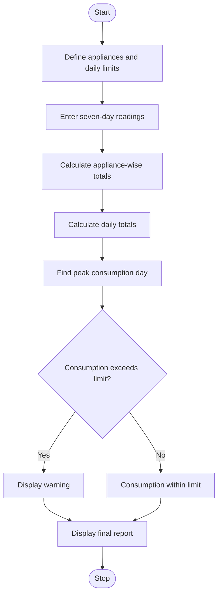

# Problem Statement
To develop a Python program using nested lists to store appliance-wise electricity consumption readings for seven days. The program calculates daily and appliance-wise total consumption, identifies the day with the highest consumption, and detects appliances or days that exceed specified electricity limits.
# Algorithm
1. Start the program.
2. Define appliance names and seven days of the week.
3. Store daily electricity readings in a nested list (in kWh).
4. Calculate the total consumption of each appliance.
5. Calculate the total electricity consumption for each day.
6. Identify the day with maximum consumption.
7. Compare appliance and daily totals with their specified limits.
8. Display totals, peak consumption, and warnings.
9. Stop the program.
# Mermaid Flowchart

# Source code

# Weekly Electricity Consumption Matrix

appliances = ["Fan", "AC", "Refrigerator", "Washing Machine"]
days = ["Mon", "Tue", "Wed", "Thu", "Fri", "Sat", "Sun"]

# Electricity consumption in kWh
readings = [
    [2, 2, 3, 2, 2, 3, 2],
    [8, 9, 10, 8, 9, 11, 10],
    [3, 3, 3, 3, 3, 3, 3],
    [0, 1, 0, 1, 0, 2, 1]
]

appliance_limits = [20, 60, 25, 10]
daily_limit = 30

print("WEEKLY ELECTRICITY CONSUMPTION")

# Appliance-wise totals
appliance_totals = []

for i in range(len(appliances)):
    total = sum(readings[i])
    appliance_totals.append(total)

    print(f"\n{appliances[i]}: {total} kWh")

    if total > appliance_limits[i]:
        print("Warning: Appliance limit exceeded!")

# Daily totals
daily_totals = []

print("\nDAILY CONSUMPTION")

for j in range(len(days)):
    total = sum(readings[i][j]
                for i in range(len(appliances)))
    daily_totals.append(total)

    print(f"{days[j]}: {total} kWh")

    if total > daily_limit:
        print("Warning: Daily limit exceeded!")

# Peak consumption day
peak_index = daily_totals.index(max(daily_totals))

print("\nPEAK CONSUMPTION")
print("Day:", days[peak_index])
print("Consumption:", daily_totals[peak_index], "kWh")

# Overall weekly consumption
print("\nTOTAL WEEKLY CONSUMPTION:",
      sum(appliance_totals), "kWh")
# Sample input
Appliances: Fan, AC, Refrigerator, Washing Machine
Days: Monday to Sunday

Fan:              2, 2, 3, 2, 2, 3, 2
AC:               8, 9, 10, 8, 9, 11, 10
Refrigerator:     3, 3, 3, 3, 3, 3, 3
Washing Machine:  0, 1, 0, 1, 0, 2, 1

Appliance limits: 20, 60, 25, 10 kWh
Daily consumption limit: 30 kWh
# Sample output
WEEKLY ELECTRICITY CONSUMPTION

Fan: 16 kWh

AC: 65 kWh
Warning: Appliance limit exceeded!

Refrigerator: 21 kWh

Washing Machine: 5 kWh

DAILY CONSUMPTION
Mon: 13 kWh
Tue: 15 kWh
Wed: 16 kWh
Thu: 14 kWh
Fri: 14 kWh
Sat: 19 kWh
Sun: 16 kWh

PEAK CONSUMPTION
Day: Sat
Consumption: 19 kWh

TOTAL WEEKLY CONSUMPTION: 107 kWh
# Screen shot

