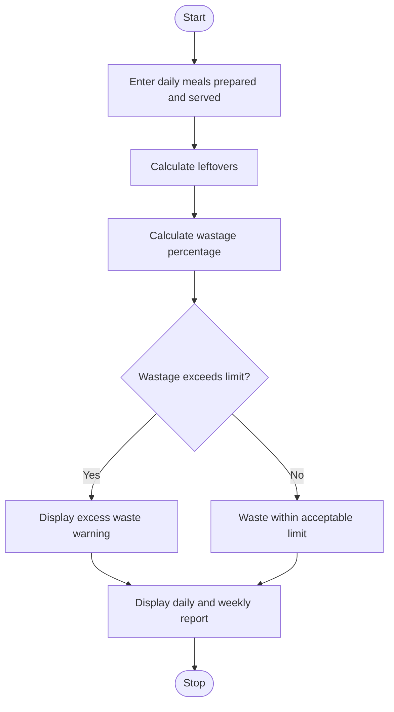

# Problem Statement
To develop a Python program that monitors food prepared, meals served, and leftovers across several days using lists. The program calculates daily food wastage, determines wastage percentages, and identifies days when food waste exceeds the acceptable limit.
# Algorithm
1. Start the program.
2. Store the days, meals prepared, and meals served.
3. Calculate leftovers using prepared meals minus served meals.
4. Calculate the food wastage percentage for each day.
5. Compare the wastage percentage with the acceptable limit.
6. Identify days exceeding the limit.
7. Display daily statistics and total weekly wastage.
8. Stop the program.
# Mermaid Flowchart

# Source code

# Food Waste Monitoring System

days = ["Monday", "Tuesday", "Wednesday",
        "Thursday", "Friday", "Saturday", "Sunday"]

prepared = [100, 120, 110, 130, 100, 150, 140]
served =   [90,  110, 100, 100, 95,  120, 130]

waste_limit = 15  # Acceptable wastage percentage

total_prepared = 0
total_served = 0
total_leftovers = 0

print("FOOD WASTE MONITORING REPORT")

for i in range(len(days)):
    leftovers = prepared[i] - served[i]
    percentage = (leftovers / prepared[i]) * 100

    total_prepared += prepared[i]
    total_served += served[i]
    total_leftovers += leftovers

    print(f"\nDay: {days[i]}")
    print("Meals prepared:", prepared[i])
    print("Meals served:", served[i])
    print("Leftovers:", leftovers)
    print(f"Wastage percentage: {percentage:.2f}%")

    if percentage > waste_limit:
        print("Warning: Acceptable waste limit exceeded!")
    else:
        print("Food waste is within the limit.")

# Weekly summary
weekly_percentage = (total_leftovers / total_prepared) * 100

print("\nWEEKLY SUMMARY")
print("Total meals prepared:", total_prepared)
print("Total meals served:", total_served)
print("Total leftovers:", total_leftovers)
print(f"Overall wastage: {weekly_percentage:.2f}%")
# Sample input
Days: Monday to Sunday

Meals prepared:
100, 120, 110, 130, 100, 150, 140

Meals served:
90, 110, 100, 100, 95, 120, 130

Acceptable wastage limit: 15%
# Sample output
FOOD WASTE MONITORING REPORT

Day: Monday
Meals prepared: 100
Meals served: 90
Leftovers: 10
Wastage percentage: 10.00%
Food waste is within the limit.

Day: Tuesday
Meals prepared: 120
Meals served: 110
Leftovers: 10
Wastage percentage: 8.33%
Food waste is within the limit.

Day: Wednesday
Meals prepared: 110
Meals served: 100
Leftovers: 10
Wastage percentage: 9.09%
Food waste is within the limit.

Day: Thursday
Meals prepared: 130
Meals served: 100
Leftovers: 30
Wastage percentage: 23.08%
Warning: Acceptable waste limit exceeded!

Day: Friday
Meals prepared: 100
Meals served: 95
Leftovers: 5
Wastage percentage: 5.00%
Food waste is within the limit.

Day: Saturday
Meals prepared: 150
Meals served: 120
Leftovers: 30
Wastage percentage: 20.00%
Warning: Acceptable waste limit exceeded!

Day: Sunday
Meals prepared: 140
Meals served: 130
Leftovers: 10
Wastage percentage: 7.14%
Food waste is within the limit.

WEEKLY SUMMARY
Total meals prepared: 850
Total meals served: 745
Total leftovers: 105
Overall wastage: 12.35%
# Screen shot

