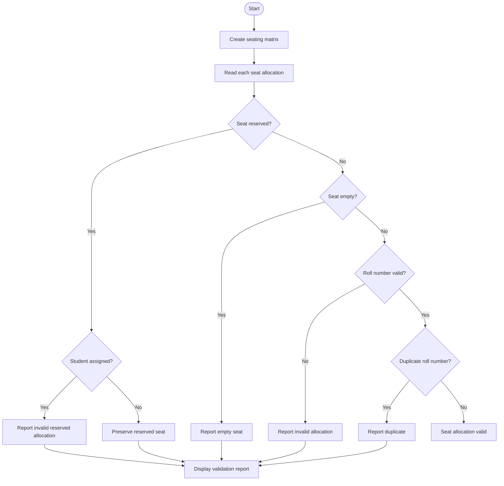

# Problem Statement
To develop a Python program using nested lists to validate an examination seating matrix. The program checks for duplicate roll numbers, preserves reserved seating positions, identifies empty seats, and detects invalid student allocations.
# Algorithm
1. Start the program.
2. Create a nested list representing rows and seats in the examination hall.
3. Mark reserved seats using a special value.
4. Check each seat for empty or invalid allocations.
5. Identify duplicate roll numbers across the seating matrix.
6. Ensure reserved seats are not assigned to students.
7. Display validation errors and the final seating report.
8. Stop the program.
# Mermaid Flowchart

# Source code

# Nested List Examination Seating Validation

RESERVED = "RESERVED"
EMPTY = None

seating = [
    [101, 102, RESERVED],
    [103, 102, EMPTY],
    [105, "ABC", 108]
]

valid_roll_numbers = {101, 102, 103, 104, 105, 106, 107, 108}

seen = set()
errors = []

print("EXAMINATION SEATING VALIDATION")

for i, row in enumerate(seating):
    for j, seat in enumerate(row):
        position = f"Row {i + 1}, Seat {j + 1}"

        if seat == RESERVED:
            print(f"{position}: Reserved seat preserved")

        elif seat is EMPTY:
            errors.append(f"{position}: Empty seat")
            print(f"{position}: Empty seat")

        elif not isinstance(seat, int) or seat not in valid_roll_numbers:
            errors.append(f"{position}: Invalid student allocation")
            print(f"{position}: Invalid student allocation ({seat})")

        elif seat in seen:
            errors.append(f"{position}: Duplicate roll number {seat}")
            print(f"{position}: Duplicate roll number {seat}")

        else:
            seen.add(seat)
            print(f"{position}: Roll number {seat} - Valid")

print("\nVALIDATION SUMMARY")
print("Total seats:", sum(len(row) for row in seating))
print("Valid student allocations:", len(seen))
print("Validation errors:", len(errors))

if errors:
    print("\nERROR DETAILS")
    for error in errors:
        print("-", error)
else:
    print("All seating allocations are valid.")
# Sample input
Row 1: 101, 102, RESERVED
Row 2: 103, 102, EMPTY
Row 3: 105, ABC, 108
Valid roll numbers: 101, 102, 103, 104, 105, 106, 107, 108
# Sample output
EXAMINATION SEATING VALIDATION
Row 1, Seat 1: Roll number 101 - Valid
Row 1, Seat 2: Roll number 102 - Valid
Row 1, Seat 3: Reserved seat preserved
Row 2, Seat 1: Roll number 103 - Valid
Row 2, Seat 2: Duplicate roll number 102
Row 2, Seat 3: Empty seat
Row 3, Seat 1: Roll number 105 - Valid
Row 3, Seat 2: Invalid student allocation (ABC)
Row 3, Seat 3: Roll number 108 - Valid

VALIDATION SUMMARY
Total seats: 9
Valid student allocations: 5
Validation errors: 3

ERROR DETAILS
- Row 2, Seat 2: Duplicate roll number 102
- Row 2, Seat 3: Empty seat
- Row 3, Seat 2: Invalid student allocation
- 
    N --> O
    O --> P([Stop])
# Problem Statement
To develop a Python program using nested lists to validate an examination seating matrix. The program checks for duplicate roll numbers, preserves reserved seating positions, identifies empty seats, and detects invalid student allocations.
# Algorithm
1. Start the program.
2. Create a nested list representing rows and seats in the examination hall.
3. Mark reserved seats using a special value.
4. Check each seat for empty or invalid allocations.
5. Identify duplicate roll numbers across the seating matrix.
6. Ensure reserved seats are not assigned to students.
7. Display validation errors and the final seating report.
8. Stop the program.
# Mermaid Flowchart

# Source code

# Nested List Examination Seating Validation

RESERVED = "RESERVED"
EMPTY = None

seating = [
    [101, 102, RESERVED],
    [103, 102, EMPTY],
    [105, "ABC", 108]
]

valid_roll_numbers = {101, 102, 103, 104, 105, 106, 107, 108}

seen = set()
errors = []

print("EXAMINATION SEATING VALIDATION")

for i, row in enumerate(seating):
    for j, seat in enumerate(row):
        position = f"Row {i + 1}, Seat {j + 1}"

        if seat == RESERVED:
            print(f"{position}: Reserved seat preserved")

        elif seat is EMPTY:
            errors.append(f"{position}: Empty seat")
            print(f"{position}: Empty seat")

        elif not isinstance(seat, int) or seat not in valid_roll_numbers:
            errors.append(f"{position}: Invalid student allocation")
            print(f"{position}: Invalid student allocation ({seat})")

        elif seat in seen:
            errors.append(f"{position}: Duplicate roll number {seat}")
            print(f"{position}: Duplicate roll number {seat}")

        else:
            seen.add(seat)
            print(f"{position}: Roll number {seat} - Valid")

print("\nVALIDATION SUMMARY")
print("Total seats:", sum(len(row) for row in seating))
print("Valid student allocations:", len(seen))
print("Validation errors:", len(errors))

if errors:
    print("\nERROR DETAILS")
    for error in errors:
        print("-", error)
else:
    print("All seating allocations are valid.")
# Sample input
Row 1: 101, 102, RESERVED
Row 2: 103, 102, EMPTY
Row 3: 105, ABC, 108
Valid roll numbers: 101, 102, 103, 104, 105, 106, 107, 108
# Sample output
EXAMINATION SEATING VALIDATION
Row 1, Seat 1: Roll number 101 - Valid
Row 1, Seat 2: Roll number 102 - Valid
Row 1, Seat 3: Reserved seat preserved
Row 2, Seat 1: Roll number 103 - Valid
Row 2, Seat 2: Duplicate roll number 102
Row 2, Seat 3: Empty seat
Row 3, Seat 1: Roll number 105 - Valid
Row 3, Seat 2: Invalid student allocation (ABC)
Row 3, Seat 3: Roll number 108 - Valid

VALIDATION SUMMARY
Total seats: 9
Valid student allocations: 5
Validation errors: 3

ERROR DETAILS
- Row 2, Seat 2: Duplicate roll number 102
- Row 2, Seat 3: Empty seat
- Row 3, Seat 2: Invalid student allocation
- 
    N --> O
    O --> P([Stop])
  # Problem Statement
To develop a Python program using nested lists to validate an examination seating matrix. The program checks for duplicate roll numbers, preserves reserved seating positions, identifies empty seats, and detects invalid student allocations.
# Algorithm
1. Start the program.
2. Create a nested list representing rows and seats in the examination hall.
3. Mark reserved seats using a special value.
4. Check each seat for empty or invalid allocations.
5. Identify duplicate roll numbers across the seating matrix.
6. Ensure reserved seats are not assigned to students.
7. Display validation errors and the final seating report.
8. Stop the program.
# Mermaid Flowchart

# Source code

# Nested List Examination Seating Validation

RESERVED = "RESERVED"
EMPTY = None

seating = [
    [101, 102, RESERVED],
    [103, 102, EMPTY],
    [105, "ABC", 108]
]

valid_roll_numbers = {101, 102, 103, 104, 105, 106, 107, 108}

seen = set()
errors = []

print("EXAMINATION SEATING VALIDATION")

for i, row in enumerate(seating):
    for j, seat in enumerate(row):
        position = f"Row {i + 1}, Seat {j + 1}"

        if seat == RESERVED:
            print(f"{position}: Reserved seat preserved")

        elif seat is EMPTY:
            errors.append(f"{position}: Empty seat")
            print(f"{position}: Empty seat")

        elif not isinstance(seat, int) or seat not in valid_roll_numbers:
            errors.append(f"{position}: Invalid student allocation")
            print(f"{position}: Invalid student allocation ({seat})")

        elif seat in seen:
            errors.append(f"{position}: Duplicate roll number {seat}")
            print(f"{position}: Duplicate roll number {seat}")

        else:
            seen.add(seat)
            print(f"{position}: Roll number {seat} - Valid")

print("\nVALIDATION SUMMARY")
print("Total seats:", sum(len(row) for row in seating))
print("Valid student allocations:", len(seen))
print("Validation errors:", len(errors))

if errors:
    print("\nERROR DETAILS")
    for error in errors:
        print("-", error)
else:
    print("All seating allocations are valid.")
# Sample input
Row 1: 101, 102, RESERVED
Row 2: 103, 102, EMPTY
Row 3: 105, ABC, 108
Valid roll numbers: 101, 102, 103, 104, 105, 106, 107, 108
# Sample output
EXAMINATION SEATING VALIDATION
Row 1, Seat 1: Roll number 101 - Valid
Row 1, Seat 2: Roll number 102 - Valid
Row 1, Seat 3: Reserved seat preserved
Row 2, Seat 1: Roll number 103 - Valid
Row 2, Seat 2: Duplicate roll number 102
Row 2, Seat 3: Empty seat
Row 3, Seat 1: Roll number 105 - Valid
Row 3, Seat 2: Invalid student allocation (ABC)
Row 3, Seat 3: Roll number 108 - Valid

VALIDATION SUMMARY
Total seats: 9
Valid student allocations: 5
Validation errors: 3

ERROR DETAILS
- Row 2, Seat 2: Duplicate roll number 102
- Row 2, Seat 3: Empty seat
- Row 3, Seat 2: Invalid student allocation
- 
    N --> O
    O --> P([Stop])
  # Screen shot
  

