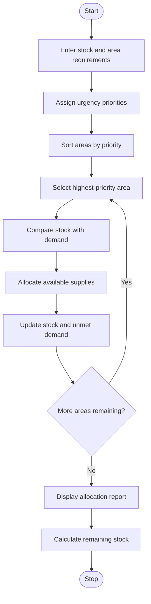

# Problem Statement
To develop a Python program using nested lists to compare available disaster relief supplies with area-wise requirements. The program identifies shortages, prioritizes areas according to urgency, allocates limited supplies based on a prescribed priority policy, and calculates the remaining unmet demand after allocation.
# Algorithm
1. Start the program.
2. Define relief supplies, affected areas, and urgency priorities.
3. Store available stock and area-wise requirements in nested lists.
4. Calculate the shortage of each supply in every area.
5. Sort areas by urgency, giving the highest priority to critical areas.
6. Allocate available supplies to each area according to priority.
7. Update the stock after every allocation.
8. Calculate remaining unmet demand and available stock.
9. Display allocation details and the final report.
10. Stop the program.
 # Mermaid Flowchart

# Source code

# Disaster Relief Supply Allocation

supplies = ["Water", "Food", "Medicine"]

# Available stock of each supply
stock = [60, 50, 25]

# Area, urgency priority, and required supplies
areas = [
    ["North Area", 1, [30, 20, 10]],  # Critical
    ["South Area", 2, [25, 25, 15]],  # High
    ["East Area", 3, [20, 20, 10]]    # Normal
]

# Lower priority number means greater urgency
areas.sort(key=lambda area: area[1])

print("DISASTER RELIEF SUPPLY ALLOCATION")

total_unmet = [0] * len(supplies)

for area, priority, requirements in areas:
    print(f"\nArea: {area}")

    for i in range(len(supplies)):
        demand = requirements[i]
        allocated = min(stock[i], demand)

        stock[i] -= allocated
        unmet = demand - allocated
        total_unmet[i] += unmet

        print(f"{supplies[i]} required: {demand}")
        print(f"{supplies[i]} allocated: {allocated}")
        print(f"{supplies[i]} unmet demand: {unmet}")

# Final report
print("\nFINAL STOCK REPORT")

for i in range(len(supplies)):
    print(f"{supplies[i]} remaining: {stock[i]}")

print("\nTOTAL UNMET DEMAND")

for i in range(len(supplies)):
    print(f"{supplies[i]}: {total_unmet[i]}")

print("\nTotal remaining stock:", sum(stock))
print("Total unmet demand:", sum(total_unmet))
# Sample input
Available stock:
Water = 60
Food = 50
Medicine = 25

Area requirements:

North Area (Critical):
Water = 30, Food = 20, Medicine = 10

South Area (High):
Water = 25, Food = 25, Medicine = 15

East Area (Normal):
Water = 20, Food = 20, Medicine = 10
# Sample output
DISASTER RELIEF SUPPLY ALLOCATION

Area: North Area
Water required: 30
Water allocated: 30
Water unmet demand: 0
Food required: 20
Food allocated: 20
Food unmet demand: 0
Medicine required: 10
Medicine allocated: 10
Medicine unmet demand: 0

Area: South Area
Water required: 25
Water allocated: 25
Water unmet demand: 0
Food required: 25
Food allocated: 25
Food unmet demand: 0
Medicine required: 15
Medicine allocated: 15
Medicine unmet demand: 0

Area: East Area
Water required: 20
Water allocated: 5
Water unmet demand: 15
Food required: 20
Food allocated: 5
Food unmet demand: 15
Medicine required: 10
Medicine allocated: 0
Medicine unmet demand: 10

FINAL STOCK REPORT
Water remaining: 0
Food remaining: 0
Medicine remaining: 0

TOTAL UNMET DEMAND
Water: 15
Food: 15
Medicine: 10

Total remaining stock: 0
Total unmet demand: 40
# Screen shot

