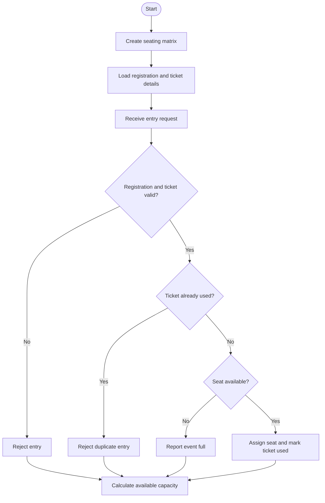

# Problem Statement
To develop a Python program using nested lists to generate seating assignments for a campus event. The program validates tickets against registered student identifiers, detects duplicate entries, assigns available seats, and calculates the remaining seating capacity.
# Algorithm
1. Start the program.
2. Create a nested list representing rows and seats.
3. Store registered student IDs and ticket IDs.
4. Accept entry requests and validate them against the registration records.
5. Check whether the ticket has already been used.
6. Assign a seat if the ticket is valid and a seat is available.
7. Reject invalid tickets and duplicate entries.
8. Calculate occupied seats and remaining capacity.
9. Display the seating assignments and entry report.
10. Stop the program.
# Mermaid Flowchart

# Source code

# Campus Event Seating and Entry Validation

seating = [
    [None, None, None],
    [None, None, None],
    [None, None, None]
]

registrations = {
    "ST101": "T101",
    "ST102": "T102",
    "ST103": "T103",
    "ST104": "T104",
    "ST105": "T105"
}

# Entry requests: (student ID, ticket ID)
entry_requests = [
    ("ST101", "T101"),
    ("ST102", "T102"),
    ("ST101", "T101"),
    ("ST106", "T106"),
    ("ST103", "T103"),
    ("ST104", "T104")
]

used_tickets = set()
assignments = {}

capacity = sum(len(row) for row in seating)

print("CAMPUS EVENT ENTRY VALIDATION")

for student, ticket in entry_requests:

    if registrations.get(student) != ticket:
        print(f"Entry rejected: Invalid ticket for {student}")
        continue

    if ticket in used_tickets:
        print(f"Entry rejected: Duplicate entry for {student}")
        continue

    # Find the first available seat
    seat_found = False

    for i in range(len(seating)):
        for j in range(len(seating[i])):
            if seating[i][j] is None:
                seating[i][j] = student
                assignments[student] = (i + 1, j + 1)
                used_tickets.add(ticket)

                print(
                    f"{student} assigned to "
                    f"Row {i + 1}, Seat {j + 1}"
                )

                seat_found = True
                break

        if seat_found:
            break

    if not seat_found:
        print(f"Entry rejected: No seats available for {student}")

# Display final seating matrix
print("\nFINAL SEATING MATRIX")

for i, row in enumerate(seating):
    print(f"Row {i + 1}: {row}")

occupied = sum(
    seat is not None
    for row in seating
    for seat in row
)

available = capacity - occupied

print("\nEVENT CAPACITY REPORT")
print("Total seats:", capacity)
print("Occupied seats:", occupied)
print("Available seats:", available)
print("Successful entries:", len(used_tickets))
# Sample input
Total seating capacity: 9

Registrations:
ST101 -> T101
ST102 -> T102
ST103 -> T103
ST104 -> T104
ST105 -> T105

Entry requests:
(ST101, T101)
(ST102, T102)
(ST101, T101)
(ST106, T106)
(ST103, T103)
(ST104, T104)
    L --> M[Display final report]
    M --> N([Stop])
# Sample output
CAMPUS EVENT ENTRY VALIDATION
ST101 assigned to Row 1, Seat 1
ST102 assigned to Row 1, Seat 2
Entry rejected: Duplicate entry for ST101
Entry rejected: Invalid ticket for ST106
ST103 assigned to Row 1, Seat 3
ST104 assigned to Row 2, Seat 1

FINAL SEATING MATRIX
Row 1: ['ST101', 'ST102', 'ST103']
Row 2: ['ST104', None, None]
Row 3: [None, None, None]

EVENT CAPACITY REPORT
Total seats: 9
Occupied seats: 4
Available seats: 5
Successful entries: 4
# Screen shot

